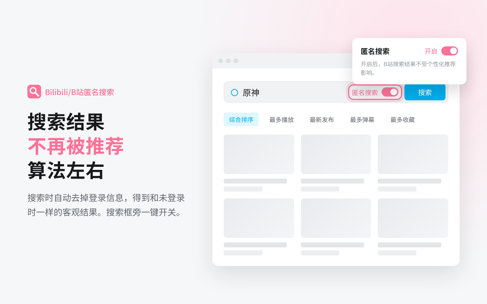

# Bilibili/B站匿名搜索

一个极简 Chrome 扩展：在 B 站网页端搜索时不携带登录信息，获得非个性化的搜索结果；看视频、评论、收藏仍保持登录。

**[➜ 从 Chrome 应用商店安装](https://chromewebstore.google.com/detail/fcaobiifgpobipiehpkfaibfdfdffpoh)**

## 为什么需要它

登录 B 站后，搜索结果会掺入个性化推荐，和未登录时看到的完全不同。比如常看游戏视频的账号搜「篮球」，结果里可能大多是篮球游戏。这个扩展让搜索结果回到关键词本身。

## 功能

- **去个性化搜索**：搜索页和搜索接口的请求不携带登录 Cookie（`SESSDATA`、`bili_jct`、`DedeUserID` 等），只保留 `buvid3` 等设备标识，得到与未登录时一致的结果。
- **刷新也有效**：刷新页面或直接打开搜索链接，同样生效。
- **不影响观看**：只作用于搜索，播放视频仍是登录状态，高清画质照常。
- **一键开关**：B 站搜索框内和扩展弹窗中都有开关，两处状态同步，切换后自动刷新；不需要的话，可以在弹窗中隐藏搜索框里的开关。

## 安装

### 从 Chrome 应用商店安装（推荐）

打开 [Chrome 应用商店页面](https://chromewebstore.google.com/detail/fcaobiifgpobipiehpkfaibfdfdffpoh)，点击「添加至 Chrome」。从商店安装的扩展会自动更新。

Edge 用户也可以从这里安装：打开页面后，按提示允许安装来自其他应用商店的扩展即可。

### 手动安装

1. 在 [Releases](../../releases) 页面下载最新的 `bili-search-anon.zip` 并解压。
2. 在 Chrome 地址栏打开 `chrome://extensions`，打开右上角的「开发者模式」。
3. 点击「加载已解压的扩展程序」，选择解压出的 `bili-search-anon` 文件夹。

Edge 等基于 Chromium 的浏览器也可以用同样的方法手动安装。

## 工作原理

扩展使用 `declarativeNetRequest`，只改写发往 `search.bilibili.com` 和 B 站搜索接口（`api.bilibili.com/x/web-interface/search`）的请求：从中去掉登录相关的 Cookie，其余 Cookie 保持不变。由于修改发生在请求发出之前，刷新页面或直接打开搜索链接时同样生效。

| 权限 | 用途 |
| --- | --- |
| `declarativeNetRequest` | 改写 B 站搜索请求的 Cookie |
| `cookies` | 在本地读取 B 站 Cookie，过滤掉登录项 |
| `storage` | 保存开关状态 |
| `*://*.bilibili.com/*` | 仅在 B 站上生效，并在搜索框旁显示开关 |

## 隐私

所有处理都在浏览器本地完成，不收集、不存储、不上传任何个人数据。详见 [隐私政策](PRIVACY.md)。

## 说明

本扩展为个人开发的非官方工具，与哔哩哔哩官方无关。B 站页面或接口调整后可能暂时失效，欢迎通过 [Issues](../../issues) 反馈。

## 许可证

[MIT](LICENSE)
